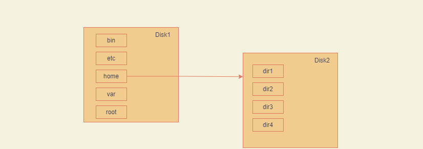

# bash Shell

***

许多Linux发行版的默认Shell是GUN bash Shell

## 1 启动Shell

GUN bash Shell是一个普通程序，提供了对Linux系统的交互式访问

通常在用户登录终端时启动

系统启动的Shell程序取决于用户账户的配置

```
1. /etc/passwd文件包含了所有系统账户 以及每个用户的基本配置信息

2. 下图中，用户root将/usr/bin/bash作为自己的默认Shell程序

3. 在root登录Linux系统后，GUN bash Shell会自行启动
```


```
4. 每个条目包含7个数据字段，字段之间用冒号分隔

5. 系统使用字段中的数据来赋予用户账户某些特性

6. 最后一个字段指定了用户使用的Shell程序

7. 采用虚拟控制台终端登录，CLI提示符会自动出现，接受shell命令输入

   通过图形化桌面环境登录Linux系统，需要启动图形化终端仿真器来访问shell
```


## 2 Shell提示符

默认的bash shell提示符是美元符号：`$`，这个符号表明shell在等待用户输入命令

不同的Linux发行版会采用不同格式的提示符

```
Ubuntu Linux系统的shell提示符：
	root@root:~$
	
CentOS Linux系统的shell提示符：
	[root@localhost ~]$
	
Arch Linux系统的shell提示符：
	[root@ArchLee ~]#
```

提示符显示了`用户名`和`主机名`两个字段信息


shell提示符并非一成不变，可以进行修改


## 3 bash手册

### 3.1 man命令

`man`命令可以访问Linux系统的手册页

在`man`命令之后跟上想要查看的命令名，就可以显示相应的手册页，格式如下：


如果存在如下情况，请确认Linux系统安装了man软件包

```
[root@ArchLee ~]# man
-bash: man: command not found
```

ArchLinux系统可以通过`pacman`命令来查看命令说明包

```
pacman [command name] -h
```


#### 3.1.1 安装man命令包

此处使用的是Arch Linux系统，由于系统未内置man软件包，因此需要手动安装

```
pacman -S man -db			//英文手册

pacman -S man-pages-zh_cn	//中文手册
```


#### 3.1.2访问英文手册

```
man man
```


#### 3.1.3 访问中文手册

```
man -L zh_CN ls
```


### 3.2 Linux手册页

`man`命令查看命令手册页时，其中的信息是由**分页程序（pager）**来显示的

```
分页程序能够逐页（或逐行）显示文本
单击空格键：翻页
Enter键：逐行查看
q键：退出手册
```


#### 3.2.1手册页惯用段名

|      段       |           描 述            |
| :-----------: | :------------------------: |
|     Name      | 显示命令名和一段简短的描述 |
|   Synopsis    |          命令语法          |
| Configuration |        命令配置信息        |
|  Description  |      命令的一般性描述      |
|    Options    |        命令选项描述        |
|  Exit Status  |       命令的退出状态       |
| Return Value  |        命令的返回值        |
|    Errors     |       命令的错误消息       |
|  Environment  |     命令使用的环境变量     |
|     Files     |       命令用到的文件       |
|   Versions    |       命令的版本信息       |
| Conforming To |       遵循的命令标准       |
|     Notes     |      其他有帮助的资料      |
|     Bugs      |       提交bug的途径        |
|    Example    |        命令用法示例        |
|    Authors    |     命令开发人员的信息     |
|   Copyright   |    命令源代码的版权状况    |
|   See Also    |   与该命令类似的其他命令   |

并非每一个命令的手册页都包含上表中的所有段名

有些命令使用的段名并没有在上面的惯用标准中列出

*命令采用的基本模式*

`COMMAND-NAME` [OPTION]... [ARGUMENT]

```
COMMADN-NAME		#要运行的命令名

[OPTION]			#用于修改命令的行为选项
					#可添加的[OPTION]，也称作开关，通常不止一个
					#[]表示OPRION并不是必须的，...（三个点）表示可以一次指定多个OPTION
					
[ARUGMENT]			#传递给命令的参数，用于指明命令的操作对象
					#ARGUMENT不是必须的，可以一次指定多个ARGUMENT
					
#如果需要使用多个命令选项，通常可以将其合并在一起
 如果要使用选项 -a 和选项 -b.那么可以写作 -ab
 
#不同命令的作者不同，因此用法也不相同，需要通过命令手册页的概要部分了解命令语法
```


#### 3.2.2搜索手册页

通过关键字来搜索手册页

语法：`man` `- k` `keyword`

```
man：命令手册

-k ：keyword / apropos ，表示命令选项为按关键字来搜索手册

keyword：关键字
```


#### 3.2.3手册页的节

Linux手册页中有不同的节，每节都分配了一个数字，从`1`开始，一直到`9`

| 节   号 |     所涵盖的内容      |
| :-----: | :-------------------: |
|    1    | 可执行程序或shell命令 |
|    2    |       系统调用        |
|    3    |        库调用         |
|    4    |       特殊文件        |
|    5    |    文件格式与约定     |
|    6    |         游戏          |
|    7    |   概览、约定及杂项    |
|    8    | 超级用户和管理员命令  |
|    9    |  内核例程（routime）  |
|         |                       |

man命令通常显示的是指定命令编号最低的节

Linux系统手册页可能包含一些非标准的节编号


###### *查看特定节*

```
man section# topicname

section#：节编号
topicname：手册名称
```


###### *info页面*

```
info info

#显示info页面的相关内容
```


###### *内建命令*

```
内建命令有自己的帮助页面

help help			//显示帮助页面信息
```


###### *-help / -h*

```
许多命令接受 -h 或 -help命令

[命令名称] -h

#查看该命令的帮助信息
```


### 3.3 文件系统

#### 3.3.1Linux文件系统

Linux系统与Windows系统之间存在明显的区别

- Linux的路径中不使用驱动器盘符

- Windows中，计算机上安装的物理驱动器的分区决定了文件路径

  

Windows会为每个物理磁盘分区分配一个盘符，每个分区都有自己的目录结构，用于访问存储在其中的文件

```
Windows系统中的文件路径示例：
	C:\Users\Stellisa\Desktop\test.doc
```

各字段含义如下：

`c:`：表示文件所在磁盘分区

`\Users\Stellisa\Desktop\test.doc`：文件路径


Linux会将文件存储在名为`虚拟目录（virtual directory）`的单个目录结构中

虚拟目录会将计算机中所有存储设备的文件路径都纳入单个目录结构

```
也就是说，在虚拟目录中没有了磁盘分区这个概念，文件由根目录出发，通过树状结构来实现延伸
```

Linux虚拟目录结构只包含一个成为`根（root）`目录的基础目录

根目录下的目录和文件会按照其访问路径一一列出

```
/root/[文件夹].../[文件]

/root：表示根目录
[文件夹]：表示文件所在的目录名称，...表示允许嵌套多层目录
[文件]：表示文件名称及类型

Linux文件路径并没有提供任何有关文件究竟存放在哪个物理磁盘中的信息
```


Linux系统中，使用`/（正斜线）`来分隔文件路径中的目录，`/（反斜线）`在Linux中用作转移字符

Windows系统中，使用`/（反斜线）`来分隔文件路径中的目录


Linux虚拟目录中的第一块硬盘称之为`根驱动器`

```
根驱动器包含了虚拟目录的核心，其他目录都是从这里开始的

系统文件通常存储在根驱动器中，用户文件存储在其它驱动器中
```


###### *挂载点*

```
Linux根驱动器中，一些特别的目录被称为挂载点

虚拟目录中分配给额外存储设备的目录

挂载，即拓展并连接

```

```
关于挂载的案例：
	我们有两块物理硬盘：Disk1和Disk2
	
	Disk安装了Linux系统
	
	Disk2则用作存储空间拓展
	
	由于Linux系统采用的是虚拟目录结构，因此需要将拓展的物理硬盘添加到系统虚拟目录结构中，令Linux系统能够识别
```




```
Linux文件系统结构推演自Unix文件系统
```


###### *内置目录*

|  目  录  |                            用  途                            |
| :------: | :----------------------------------------------------------: |
|    /     |             虚拟目录的根目录，通常不会将文件放置             |
|   /bin   |        二进制文件目录，存放了很多用户级的GUN实用工具         |
|  /boot   |                    引导目录，存放引导文件                    |
|   /dev   |              设备目录。Linux在其中创建设备节点               |
|   /etc   |                       系统配置文件目录                       |
|  /home   |          主目录，Linux n在其中创建用户目录（可选）           |
|   /lib   |                    库目录，存放系统和应用                    |
| /libname |      库目录，存放替代格式的系统和应用程序库文件（可选）      |
|  /media  |             媒介目录，可移动存储设备的常用挂载点             |
|   /mnt   |          挂载目录，用于临时挂载文件系统的常用挂载点          |
|   /opt   |                  可选目录，存放第三方软件包                  |
|  /proc   |        进程目录，存放现有内核、系统以及进程的相关信息        |
|  /root   |                  root用户的主要目录（可选）                  |
|   /run   |                运行目录，存放系统的运行时数据                |
|  /sbin   |       系统二进制文件目录，存放了很多管理级的GUN实工具        |
|   /srv   |               服务目录，存放本地服务的相关文件               |
|   /sys   |       系统目录，存放设备、驱动程序以及部分内核特性信息       |
|   /tmp   |          临时目录，可以在其中创建和删除临时工作文件          |
|   /usr   | 用户目录，一个次目录层级结构（secondary directory hierarchy） |
|   /var   |         可变目录，存放经常变化的文件，例如日志文件等         |
|          |                                                              |

常见的Linux目录名均基于文件系统层级标准（Filesystem hirearchy standard,FHS）

```
登录Linux系统后，shell会话会从主目录开始

主目录是用户账户的一个特有目录，在创建用户账户时，系统通常会为其分配主目录
```


#### 3.3.2 文件交互命令

Linux命令中的选项不仅可以分开输入，也支持合并输入

```
ls -a -F -R			//分开输入

ls -aFR			   //合并输入
```


##### 3.3.2.1 文件路径

###### *绝对路径*

```
绝对路径定义了在虚拟目录结构中，该目录从根目录开始的确切位置，即完整的目录名
绝对路径总是以正斜线（/）作为起始，以指明虚拟文件系统的根目录

例如：
	已知文件夹 .ssh处于root目录下，我们需要访问它，需要如下命令：
	cd /root/.ssh
	Linux系统会自动跳转至.ssh目录
```


文件系统中的`~`（波浪号）

```
~ 表明shell会话当前位于主目录中
离开主目录之后，提示符中的目录会随之变化
```


###### *相对路径*

```
相对路径允许指定一个基于当前位置的目标路径

相对路径不以代表根目录的正斜线（/）开头，而是以目录名 或是 一个特殊字符开始，只能跳转到该目录下的一级子目录
```

相对路径中的特殊字符

- `.`(单点号)：表示当前工作目录
- `..`(双点号)：表示当前工作目录的父目录


###### 隐藏文件

隐藏文件通常是文件名以`.`（点号）开始的文件

```
1. 隐藏文件在Linux中被用于保存配置信息

2. 隐藏文件不会在ls命令的默认输出中出现
```


##### 3.3.2.2`cd`命令

###### *全称*

Change Directory，即`切换目录`

***

###### *作用*

将shell会话中当前目录切换至另一个目录

***

###### *参数*

```
[destination]

#destination参数有两种表示方式：
	绝对路径
	相对路径
```

***

###### *语法*

```
cd [destination]
```

***

###### 小细节

相对路径不支持跨级别子目录切换

`example`

已知`/`文件夹下拥有如下文件夹

`bin  boot  dev  etc  home  lib  lib64  mnt  opt  proc  root  run  sbin  srv  sys  tmp  usr  var`

`/root`文件夹下拥有如下文件夹

`test`

则：

```
/为工作目录时，cd test命令是无效的

[root@ArchLee /]# cd test
-bash: cd: test: No such file or directory
```

切换至`test`文件夹，必须通过如下方式之一：

- 1. cd /root/test

  

- 2. cd root

     cd test


***

###### *示例*

`cd ..`

`描述`：返回父目录（上级目录）


`cd root`

`描述`：切换到 `/` 目录下的子目录`root`

`路径类型`：相对路径


`cd /root/test`

`描述`：将当前目录切换至test目录

`路径类型`：绝对路径


##### 3.3.2.3 `pwd`命令

###### *全称*

`print name of current/working directory`，即`打印当前/工作目录`

***

###### *作用*

显示出shell会话的当前目录，该目录被称为`当前工作目录`

***

###### *参数*

```
     -L, --logical
            use PWD from environment, even if it contains symlinks

     -P, --physical
            resolve all symlinks

     --help
            display this help and exit

     --version
            output version information and exit
```

***

###### *语法*

```
pwd [OPTION]...
```

***

###### *示例*

`pwd`

`描述`：显示当前目录


`pwd -L`

`描述`：


`pwd -P`

`描述`：


##### 3.3.2.4 `ls`命令

###### *全称*

list directory contents，即`列出目录中的内容`

***

###### *作用*

列出当前目录下的子目录和文件

***

###### *参数*

```
  -a, --all
            do not ignore entries starting with .

     -A, --almost-all
            do not list implied . and ..

     --author
            with -l, print the author of each file

     -b, --escape
            print C-style escapes for nongraphic characters

     --block-size=SIZE
            with -l, scale sizes by SIZE when printing them; e.g., '--block-size=M'; see SIZE format below

     -B, --ignore-backups
            do not list implied entries ending with ~

     -c     with  -lt:  sort by, and show, ctime (time of last change of file status information); with -l: show ctime and sort by name; otherwise: sort by
            ctime, newest first

     -C     list entries by columns

     --color[=WHEN]
            color the output WHEN; more info below

     -d, --directory
            list directories themselves, not their contents

     -D, --dired
            generate output designed for Emacs' dired mode

     -f     same as -a -U

     -F, --classify[=WHEN]
            append indicator (one of */=>@|) to entries WHEN

     --file-type
            like -F, except do not append '*'

     --format=WORD
            across,horizontal (-x), commas (-m), long (-l), single-column (-1), verbose (-l), vertical (-C)

     --full-time
            like -l --time-style=full-iso

     -g     like -l, but do not list owner

     --group-directories-first
            group directories before files

     -G, --no-group
            in a long listing, don't print group names

     -h, --human-readable
            with -l and -s, print sizes like 1K 234M 2G etc.

     --si   likewise, but use powers of 1000 not 1024

     -H, --dereference-command-line
            follow symbolic links listed on the command line

     --dereference-command-line-symlink-to-dir
            follow each command line symbolic link that points to a directory

     --hide=PATTERN
            do not list implied entries matching shell PATTERN (overridden by -a or -A)

     --hyperlink[=WHEN]
            hyperlink file names WHEN

     --indicator-style=WORD
            append indicator with style WORD to entry names: none (default), slash (-p), file-type (--file-type), classify (-F)

     -i, --inode
            print the index number of each file

     -I, --ignore=PATTERN
            do not list implied entries matching shell PATTERN

     -k, --kibibytes
            default to 1024-byte blocks for file system usage; used only with -s and per directory totals

     -l     use a long listing format

     -L, --dereference
            when showing file information for a symbolic link, show information for the file the link references rather than for the link itself

     -m     fill width with a comma separated list of entries

      -n, --numeric-uid-gid
            like -l, but list numeric user and group IDs
            
     -N, --literal
            print entry names without quoting

	 -o     like -l, but do not list group information

     -p, --indicator-style=slash
            append / indicator to directories

     -q, --hide-control-chars
            print ? instead of nongraphic characters

     --show-control-chars
            show nongraphic characters as-is; the default, unless program is 'ls' and output is a terminal

     -Q, --quote-name
            enclose entry names in double quotes

     --quoting-style=WORD
            use quoting style WORD for entry names: literal, locale, shell, shell-always, shell-escape, shell-escape-always, c, escape (overrides QUOTING_STYLE environment variable)

     -r, --reverse
            reverse order while sorting

     -R, --recursive
            list subdirectories recursively

     -s, --size
            print the allocated size of each file, in blocks

     -S     sort by file size, largest first

     --sort=WORD
            change default 'name' sort to WORD: none (-U), size (-S), time (-t), version (-v), extension (-X), name, width

     --time=WORD
            select  which  timestamp used to display or sort; access time (-u): atime, access, use; metadata change time (-c): ctime, status; modified time (default): mtime, modification; birth time: birth, creation; with -l, WORD de‐
            termines which time to show; with --sort=time, sort by WORD (newest first)

     --time-style=TIME_STYLE
            time/date format with -l; see TIME_STYLE below

     -t     sort by time, newest first; see --time

     -T, --tabsize=COLS
            assume tab stops at each COLS instead of 8

     -u     with -lt: sort by, and show, access time; with -l: show access time and sort by name; otherwise: sort by access time, newest first

     -U     do not sort directory entries

     -v     natural sort of (version) numbers within text

     -w, --width=COLS
            set output width to COLS.  0 means no limit

     -x     list entries by lines instead of by columns

     -X     sort alphabetically by entry extension
     
     
     -Z, --context
            print any security context of each file

     --zero
            end each output line with NUL, not newline

     -1     list one file per line

     --help
            display this help and exit

     --version
            output version information and exit
```

***

###### *语法*

```
ls [OPTION]... [FILE]...
```

***

###### *小细节*

`ls -l`


长列表格式输出字段含义

 - 输出的第一行显示了为该目录中的文件所分配的总块数（total字段）
 - 此后每一行都包含了关于文件（或目录）的下列信息（各列，从左往右）

   1. 文件类型：目录（d）、文件（-）、链接文件（l）、字符设备（c）、块设备（b）
2. 文件的权限
   3. 文件的硬链接数
4. 文件属主
   5. 文件属组
6. 文件大小（以字节为单位）
   7. 文件的上次修改时间
8. 文件名或目录


*过滤输出列表*

`过滤器`

过滤器是一个字符串，可以做简单的文本匹配

`过滤器类型`

- 1. 文件名
- 2. 标准通配符（wildcaard）

```
标准通配符的匹配模式：
	1. 问号（?）：代表任意单个字符
	2. 星号（*）：代表零个或多个字符

关于通配符：
1. * （星号）和 ? （问号）被称作通配符匹配（globbing），指使用通配符进行模式匹配的过程

2. 通配正式名称为：元字符通配符（meracharacter wildcard），除了星号和问号，还有更多元字符通配符可以做文件匹配使用

3. 其他元通配符：
	[]：方括号，表示单个字符位置并给出了该位置上的多个可能的选择
	! ：感叹号，表示单个字符的位置排除给定的字符
```

`示例`

```
#方括号通配符
	ls -l t[abe]st2.c
```


```
#感叹号通配符
	ls -l t[!a]st?.c
```


***

`语法`

```
#文件名作为过滤器
	ls -l test.c
```


```
#通配符作为过滤器
	1. ls -l test?.c		// ?号通配符
	2. ls -l tes*.c		   //  *号通配符
```

`?号通配符`


`*号通配符`


***

###### *示例*

`ls -a`	/	`ls --all`

`描述`：


`ls -A`	/	`ls --almost-all`

`描述`：


`ls -l --author`	/	`ls --author -l`

`描述`：`--author`参数需要同`-l`参数一同使用，在长列表格式信息中额外显示文件的作者


`ls -b`	/	`ls --escape`

`描述`：


##### 3.2.2.5 `touch`命令

###### *全称*

touch，触摸

***

###### *作用*

创建指定的文件，并将用户名作为该文件的属主，并更新文件的时间戳（timestamp）

***

###### *参数*

```
     -a     change only the access time

     -c, --no-create
            do not create any files

     -d, --date=STRING
            parse STRING and use it instead of current time

     -f     (ignored)

     -h, --no-dereference
            affect each symbolic link instead of any referenced file; useful only on systems that can change the  time‐
            stamps of a symlink

     -m     change only the modification time

     -r, --reference=FILE
            use this file's times instead of current time

     -t [[CC]YY]MMDDhhmm[.ss]
            use specified time instead of current time, with a date-time format that differs from -d's

     --time=WORD
            specify which time to change: access time (-a): 'access', 'atime', 'use'; modification time (-m): 'modify',
            'mtime'

     --help
            display this help and exit

     --version
            output version information and exit
```

***

###### *语法*

```
# 创建一个空文件
touch [filename]

# 创建多个空文件
touch [filename]...

# 更新文件时间戳
touch [already exist filename]

# 附加参数
touch [filename]...[options]...
```

`touch toc1.c`

`描述`：创建一个名为`toc1.c`的空文件


`touch toc2.c toc3.c toc4.c`

`描述`：创建名为`toc2.c`、`toc3.c`、`toc4.c`的空文件


***

###### *示例*


##### 3.2.2.6 `cp`命令

###### *全称*

`copy`，复制

***

###### *作用*

将`文件` / `目录`从文件系统的一个位置复制到另一个位置

***

###### *参数*

```
# 源对象
  source object	

# 目标对象
  destination object
```

如果`source` 和 `destination`都是文件名时，新的目标文件会以`destination`命名

新文件会有新的修改时间


```
     -a, --archive
            same as -dR --preserve=all

     --attributes-only
            don't copy the file data, just the attributes

     --backup[=CONTROL]
            make a backup of each existing destination file

     -b     like --backup but does not accept an argument

     --copy-contents
            copy contents of special files when recursive

     -d     same as --no-dereference --preserve=links

     --debug
            explain how a file is copied.  Implies -v

     -f, --force
            if  an existing destination file cannot be opened, remove it and try again (this option is ignored when the
            -n option is also used)

     -i, --interactive
            prompt before overwrite (overrides a previous -n option)

     -H     follow command-line symbolic links in SOURCE

     -L, --dereference
            always follow symbolic links in SOURCE

     -P, --no-dereference
            never follow symbolic links in SOURCE

     --keep-directory-symlink
            follow existing symlinks to directories

     -l, --link
            hard link files instead of copying

     -n, --no-clobber
            (deprecated) silently skip existing files.  See also --update

     -p     same as --preserve=mode,ownership,timestamps

     --preserve[=ATTR_LIST]
            preserve the specified attributes

     --no-preserve=ATTR_LIST
            don't preserve the specified attributes

     --parents
            use full source file name under DIRECTORY

     -R, -r, --recursive
            copy directories recursively

     --reflink[=WHEN]
            control clone/CoW copies. See below

     --remove-destination
            remove each existing destination file before attempting to open it (contrast with --force)

     --sparse=WHEN
            control creation of sparse files. See below

     --strip-trailing-slashes
            remove any trailing slashes from each SOURCE argument

     -s, --symbolic-link
            make symbolic links instead of copying

     -S, --suffix=SUFFIX
            override the usual backup suffix

     -t, --target-directory=DIRECTORY
            copy all SOURCE arguments into DIRECTORY

     -T, --no-target-directory
            treat DEST as a normal file

     --update[=UPDATE]
            control which existing files are updated; UPDATE={all,none,none-fail,older(default)}

     -u     equivalent to --update[=older].  See below

     -v, --verbose
            explain what is being done

     -x, --one-file-system
            stay on this file system

     -Z     set SELinux security context of destination file to default type

     --context[=CTX]
            like -Z, or if CTX is specified then set the SELinux or SMACK security context to CTX

     --help
            display this help and exit

     --version
            output version information and exit
```

***

###### *语法*

```
cp [source] [destination]		//将source文件中的内容复制到destination文件中
```

`cp toc1.c toc2.c`

`描述`：将文件`toc1.c`中的内容复制到文件`toc2.c`中，并自动更新`toc2.c`文件的时间戳


```
cp [source] [floder path]	//将source文件复制到给定的目录路径中
```

`cp toc1.c /root/test/`

`描述`：将`toc1.c`文件复制到指定目录中


***

###### *小提示*

`cp`命令

`cp`命令将文件复制到指定目录中，给定目录末尾需要加 `/` 正斜线，用于表明给定的目标对象是目录，而非文件

```
cp [source] [destination]/		//表明目标对象是目录，因此若目标对象不存在时，会复制失败
	
cp [source] [destination]		//当目标对象不存在时，系统会自动创建名为 目标对象名 的文件，并将源文件复制到此处
```

*示例*

`cp toc1.c /root/test/newFloder`

`描述`：将`toc1.c`复制到 `/root/test/newFloder`路径中

​	     若`newFloder`目录不存在，则创建名为`newFloder`的文件，并将`toc1.c`文件中的内容复制到`newFloder`中

​	     若`newFloder`目录存在，则将`toc1.c`文件复制到`newFloder`目录中

`newFloder`不存在：


`newFloder`存在：


`cp toc1.c /root/test/newFloder/`

`描述`：将`toc1.c`复制到`/root/test/newFloder`目录中

​	     若`newFloder`目录不存在，则报错：`cp: cannot create regular file '/roor/test/newFloder/': Not a directory`

​	     若`newFloder`目录存在，则将`toc1.c`文件复制到`newFloder`目录中


`cp命令中的通配符`

`.`（单点符号）

`含义`：表示当前工作目录


